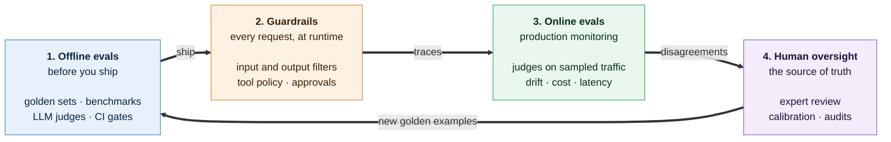
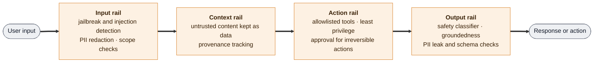

<div align="center">

# Judging the Machines

### A field guide to LLM as a Judge, evals, and guardrails for every industry

*How the industry measures the quality of LLM outputs, agents, and RAG systems, and how it keeps them safe and within limits. Built from the research of 2024, 2025, and 2026.*

   

</div>

***

## Why this repo exists

Every team shipping an LLM product eventually hits the same wall. The demo looks great, then production traffic arrives and nobody can say with confidence whether version 7 of the prompt is actually better than version 6, whether the agent is quietly skipping steps, or whether a single crafted email can make the assistant leak customer data.

Evaluation is the bottleneck. Guardrails are the seatbelt. This repo collects, in one place, the methods, benchmarks, papers, and open source tools that exist today for both, with an emphasis on what was published in **2025 and 2026**, and a practical playbook so that any industry can pick what applies to it.

Who this is for:

* **ML and AI engineers** building eval pipelines and judge models
* **Product and platform teams** deciding what "good" means for their assistant or agent
* **Safety, trust, and compliance teams** choosing guardrails and red teaming strategies
* **Researchers** looking for a map of the field and its open problems

***

## Table of contents

1. [The evaluation stack in one picture](#1-the-evaluation-stack-in-one-picture)
2. [LLM as a Judge: the fundamentals](#2-llm-as-a-judge-the-fundamentals)
3. [How judges fail: biases and attacks](#3-how-judges-fail-biases-and-attacks)
4. [Judging the judge: meta evaluation](#4-judging-the-judge-meta-evaluation)
5. [Training better judges and reward models](#5-training-better-judges-and-reward-models)
6. [Rubric based evaluation](#6-rubric-based-evaluation)
7. [Evaluating agents](#7-evaluating-agents)
8. [Evaluating RAG, grounding, and hallucination](#8-evaluating-rag-grounding-and-hallucination)
9. [Safety evals and red teaming](#9-safety-evals-and-red-teaming)
10. [Guardrails: keeping agents within limits](#10-guardrails-keeping-agents-within-limits)
11. [Industry playbook](#11-industry-playbook)
12. [Building a production eval loop](#12-building-a-production-eval-loop)
13. [Metrics glossary](#13-metrics-glossary)
14. [Open source tools and frameworks](#14-open-source-tools-and-frameworks)
15. [Reading list by year](#15-reading-list-by-year)
16. [Open problems](#16-open-problems)
17. [Contributing and citation](#17-contributing-and-citation)

> **Note on naming:** paper titles and product names are written exactly as their authors published them (for example *SWE-bench* or *Terminal-Bench*) so you can search for them.

***

## 1. The evaluation stack in one picture

Think of quality and safety as four layers that work together. Most teams only build the first one and wonder why production still surprises them.



| Layer | When it runs | Speed and cost | What it catches |
|:--|:--|:--|:--|
| **Offline evals** | Before every release | Fast, cheap | Regressions, known failure modes, benchmark gaps |
| **Guardrails** | On every request | Milliseconds, per call cost | Unsafe input, unsafe output, risky tool calls |
| **Online evals** | Continuously, on sampled traffic | Minutes to hours | Drift, new failure modes, cost and latency spikes |
| **Human oversight** | Weekly or on escalation | Slow, most expensive | Judge errors, rubric gaps, high stakes edge cases |

The loop matters more than any single layer: what humans find in production becomes tomorrow's offline test case.

**Three kinds of graders exist, and you want all three:**

| Grader type | What it is | Best for | Weakness |
|:--|:--|:--|:--|
| **Code based** | Exact match, regex, JSON schema, unit tests, SQL execution, database state checks | Anything verifiable: math answers, code, structured output, tool call arguments, final agent state | Cannot judge tone, helpfulness, nuance |
| **Model based** (LLM as a Judge) | An LLM scores or compares outputs against criteria or a rubric | Open ended quality: helpfulness, faithfulness, tone, policy compliance, reasoning quality | Biased, gameable, needs validation |
| **Human** | Domain experts or trained annotators | Ground truth, calibration, high stakes edge cases | Slow, expensive, inconsistent between people |

The golden rule that every 2025 and 2026 paper keeps rediscovering: **use code where you can, use a judge where you must, and use humans to keep the judge honest.**

***

## 2. LLM as a Judge: the fundamentals

LLM as a Judge means using a language model to evaluate the output of another model (or itself). The idea took off with the MT-Bench and Chatbot Arena work in 2023, which showed that strong models agree with human preferences at roughly the same rate humans agree with each other. Since then it has become the default way the industry scores open ended outputs.

Two major surveys map the territory and are the best starting points:

* **A Survey on LLM-as-a-Judge** (Gu et al., revised October 2025). Organizes the field around one question: how do you build a judge you can actually rely on? It covers ways to improve judges, ways to measure their reliability, and proposes a benchmark for the purpose. [arXiv:2411.15594](https://arxiv.org/abs/2411.15594)
* **From Generation to Judgment: Opportunities and Challenges of LLM-as-a-judge** (Li et al., EMNLP 2025). Builds a taxonomy along three axes: what to judge, how to judge, and how to benchmark judges. [arXiv:2411.16594](https://arxiv.org/abs/2411.16594)

### 2.1 Judging formats

| Format | Input to judge | Output | When to use |
|:--|:--|:--|:--|
| **Pointwise (absolute)** | One response + criteria | Score (binary, 1 to 5, 1 to 10) | Monitoring, thresholds, regression tests |
| **Pairwise (relative)** | Two responses + criteria | A wins / B wins / tie | Comparing prompts, models, or versions; more stable than absolute scores |
| **Listwise / best of N** | N responses | Ranking or single best | Reward modeling, reranking, best of N sampling |
| **Reference based** | Response + gold answer | Match / no match, or similarity score | When a correct answer exists but wording varies |
| **Reference free** | Response + context only | Score | Open ended tasks with no single right answer |
| **Rubric / checklist** | Response + instance specific criteria | Per criterion pass/fail, aggregated | High stakes domains (health, legal, finance); see [Section 6](#6-rubric-based-evaluation) |
| **Trajectory** | Full agent trace (thoughts, tool calls, observations) | Step level and task level scores | Agents; see [Section 7](#7-evaluating-agents) |

### 2.2 Anatomy of a good judge prompt

A judge prompt that works in production almost always has these parts:

1. **Role and task.** What is being evaluated and why.
2. **Explicit criteria.** One criterion per judge call is more reliable than "rate overall quality."
3. **A scoring scale with anchors.** Describe what a 1, a 3, and a 5 look like. Binary pass/fail is often more reliable than wide numeric scales.
4. **Reasoning before verdict.** Ask the judge to explain, then score. Reasoning judges (see J1 below) are measurably better.
5. **Structured output.** JSON with fields for reasoning and verdict so code can parse it.
6. **Escape hatches.** Allow "cannot determine" so the judge does not guess.

```text
You are evaluating whether an AI assistant's answer is FAITHFUL to the provided context.

CRITERION
An answer is faithful if every factual claim in it is supported by the context.
Claims that are common knowledge but absent from the context count as UNSUPPORTED.

SCALE
PASS  : every claim is supported by the context
FAIL  : at least one claim is unsupported or contradicts the context
UNSURE: the context is ambiguous and a careful human could go either way

INSTRUCTIONS
1. List each factual claim in the answer.
2. For each claim, quote the supporting span from the context or write NONE.
3. Decide the verdict using the scale above.
4. Ignore style, length, and formatting. They are not part of this criterion.

<context>{context}</context>
<question>{question}</question>
<answer>{answer}</answer>

Respond in JSON: {"claims": [...], "reasoning": "...", "verdict": "PASS|FAIL|UNSURE"}
```

### 2.3 Classic foundations worth knowing

| Paper | Year | Why it matters |
|:--|:--|:--|
| Judging LLM-as-a-Judge with MT-Bench and Chatbot Arena | 2023 | The paper that made LLM judges mainstream and first catalogued position, verbosity, and self enhancement bias. [arXiv:2306.05685](https://arxiv.org/abs/2306.05685) |
| G-Eval | 2023 | Chain of thought plus form filling for NLG evaluation; weights scores by token probabilities. [arXiv:2303.16634](https://arxiv.org/abs/2303.16634) |
| Large Language Models are not Fair Evaluators | 2023 | Showed that simply swapping answer order flips verdicts; proposed calibration fixes. [arXiv:2305.17926](https://arxiv.org/abs/2305.17926) |
| LLMBar | 2023 | Benchmark that tests whether judges reward instruction following over superficial polish. [arXiv:2310.07641](https://arxiv.org/abs/2310.07641) |
| JudgeLM | 2023 | Fine tuned open judges with techniques like swap augmentation. [arXiv:2310.17631](https://arxiv.org/abs/2310.17631) |
| Prometheus 2 | 2024 | Open judge model supporting both direct scoring and pairwise ranking with custom rubrics. [arXiv:2405.01535](https://arxiv.org/abs/2405.01535) |
| Replacing Judges with Juries (PoLL) | 2024 | A panel of smaller, diverse models beats one large judge on cost and bias. [arXiv:2404.18796](https://arxiv.org/abs/2404.18796) |
| Chatbot Arena | 2024 | Crowdsourced pairwise human preferences with Bradley Terry ranking. [arXiv:2403.04132](https://arxiv.org/abs/2403.04132) |
| Length Controlled AlpacaEval | 2024 | Regression based correction for the length bias of automatic win rates. [arXiv:2404.04475](https://arxiv.org/abs/2404.04475) |
| Arena-Hard / BenchBuilder | 2024 | Automatically curating hard prompts from live data to separate strong models. [arXiv:2406.11939](https://arxiv.org/abs/2406.11939) |

***

## 3. How judges fail: biases and attacks

This is where 2025 and 2026 research has been most active. The short version: **judges are measurement instruments, and every instrument has systematic error.** You need to know which errors yours has.

### 3.1 The bias catalog

| Bias | What happens | Mitigation |
|:--|:--|:--|
| **Position bias** | Judge prefers the first (or second) answer in pairwise setups | Evaluate both orders; count a win only if it holds in both; otherwise tie |
| **Verbosity / length bias** | Longer answers win regardless of quality | Length controlled scoring; instruct the judge to ignore length; include short correct answers in calibration data |
| **Style / formatting bias** | Markdown, headers, and bullet lists beat plain prose with the same content | Strip or normalize formatting before judging; explicit instructions; test with format swapped pairs |
| **Self preference** | A model rates its own outputs (or its family's) higher | Use a judge from a different model family; use juries of diverse models |
| **Authority / citation bias** | Fake references or confident tone inflate scores | Verify citations with tools; penalize unverifiable claims |
| **Sycophancy to the prompt** | Judge agrees with whatever the user or response asserts | Hide user opinions from the judge; evaluate against criteria, not claims |
| **Master key attacks** | Trivial strings fool the judge into a positive verdict | Adversarial negatives in training; reference checks; code verifiers where possible |
| **Hidden shortcuts** | Metadata cues swing verdicts, but the judge's explanation never mentions them | Strip metadata; perturbation tests; do not trust rationales as proof of process |
| **Rigid priors** | Judge ignores your custom safety or policy definition and applies its own | Test steerability against your policy; fine tune or use policy following classifiers |

### 3.2 Key papers on judge failure (2025 and 2026)

* **One Token to Fool LLM-as-a-Judge** (Zhao et al., NeurIPS 2025). Found that generative reward models used in RL with verifiable rewards can be tricked into false positives by trivial "master key" inputs such as punctuation or generic reasoning openers, affecting proprietary judges too. Their fix is data augmentation with truncated outputs as adversarial negatives. **Lesson: if a judge is your reward signal, your policy will find its loopholes.** [arXiv:2507.08794](https://arxiv.org/abs/2507.08794)

* **The Judge Who Never Admits: Hidden Shortcuts in LLM-based Evaluation** (February 2026). Injected synthetic metadata cues into evaluation prompts across six judge models and found verdicts shift substantially while the judges rarely acknowledge the cue in their explanations. **Lesson: a judge's rationale is not an audit trail.** [arXiv:2602.07996](https://arxiv.org/abs/2602.07996)

* **Judging the Judges: A Systematic Evaluation of Bias Mitigation Strategies in LLM-as-a-Judge Pipelines** (2026). Compared nine debiasing strategies across five judge models from four providers. Headline: a mid tier model with the right debiasing matched or beat frontier judges at a fraction of the cost, and style bias (favoring markdown) was far larger than position bias yet rarely studied. [arXiv:2604.23178](https://arxiv.org/abs/2604.23178)

* **LLM-Judges Exhibit Rigid Priors** (June 2026). Studied safety judges and found they can absorb new context but rarely change verdicts when your safety definition contradicts their internal priors. **Lesson: test whether your judge actually follows your policy, not its own.** [arXiv:2606.07874](https://arxiv.org/abs/2606.07874)

* **FairJudge: An Adaptive, Debiased, and Consistent LLM-as-a-Judge** (February 2026). Targets three problems at once: poor adaptation to domain criteria, biases driven by non semantic cues (position, length, format, provenance), and contradictions between pointwise and pairwise modes. [arXiv:2602.06625](https://arxiv.org/abs/2602.06625)

* **Auditing the Judge (HUB-J)** (ICML 2026). Discovers bias factors automatically from cases where humans and the judge disagree, quantifies their strength with controlled edits, then corrects judgments with a lightweight regression, no retraining needed. [ICML 2026](https://icml.cc/virtual/2026/76920)

* **Quantifying and Mitigating Self Preference Bias of LLM Judges** (2026). [arXiv:2604.22891](https://arxiv.org/abs/2604.22891)

* **CARE: Confounder Aware Aggregation for Reliable LLM Evaluation** (2026). [arXiv:2603.00039](https://arxiv.org/abs/2603.00039)

* Earlier essentials: position bias at scale ([arXiv:2406.07791](https://arxiv.org/abs/2406.07791)), self recognition and self preference ([arXiv:2404.13076](https://arxiv.org/abs/2404.13076)), style over substance ([arXiv:2307.03025](https://arxiv.org/abs/2307.03025)).

### 3.3 A minimal position bias check

```python
def judge_pairwise_debiased(judge, prompt, answer_a, answer_b):
    """Run the judge in both orders. Only count a win if it survives the swap."""
    first = judge(prompt, answer_a, answer_b)    # returns "A", "B", or "TIE"
    second = judge(prompt, answer_b, answer_a)   # same answers, swapped slots

    # map the swapped verdict back to the original labels
    second_mapped = {"A": "B", "B": "A", "TIE": "TIE"}[second]

    if first == second_mapped:
        return first          # consistent verdict
    return "TIE"              # inconsistent, so the judge was guessing on position
```

Track the **inconsistency rate** of this function over time. If it is above roughly 15 to 20 percent on your data, your judge is not ready to make shipping decisions.

***

## 4. Judging the judge: meta evaluation

Before you trust any judge, measure it against humans on **your** data. Generic leaderboard numbers do not transfer to your domain.

### 4.1 The validation recipe

1. **Build a calibration set.** 100 to 300 examples, labeled by domain experts, deliberately including hard and borderline cases.
2. **Run the judge** on the same examples.
3. **Measure agreement with chance correction.** Use Cohen's kappa (binary or categorical) or Krippendorff's alpha, plus Spearman or Kendall correlation for scores. Raw percent agreement is misleading when classes are imbalanced.
4. **Read the disagreements.** Every disagreement is either a judge bug, a rubric ambiguity, or a human labeling error. All three are valuable.
5. **Iterate the rubric**, not just the prompt. Shreya Shankar's *Who Validates the Validators?* showed that people refine their criteria as they grade, which is called criteria drift, so expect the rubric to change. [arXiv:2404.12272](https://arxiv.org/abs/2404.12272)
6. **Validate again** whenever you change the judge model, the prompt, or the product.

### 4.2 Why exact match agreement is not enough

* **Reliability without Validity** (June 2026). The largest systematic judge study so far: 21 judges from nine providers, three benchmarks (MT-Bench, JudgeBench, RewardBench), three protocols covering agreement, consistency, and bias, totaling about 541,000 judgments. Core warning: the common practice of validating judges with exact match agreement does not correct for chance and overstates how well judges actually discriminate. A judge can be consistent and still wrong. [arXiv:2606.19544](https://arxiv.org/abs/2606.19544)

* **LLM Judges Have Dark Current: A Psychometric Datasheet for LLM-as-a-Judge Evaluation** (June 2026). Argues a judge should be reported like a measurement instrument, not a single accuracy number. Proposes a "Judge Datasheet" that measures how the judge behaves on empty inputs, sensitivity to surface variation of equal quality, positional false preference, and sensitivity along a controlled quality ladder. A memorable finding: prompting tends to move the judge's decision threshold, not its resolution. [arXiv:2606.15610](https://arxiv.org/abs/2606.15610)

* **Evaluating the Reliability and Fidelity of Automated Judgment Systems** (March 2026). Tests 37 conversational LLMs across five judge prompts, second level judges, and fine tuned assessors. [arXiv:2603.22214](https://arxiv.org/abs/2603.22214)

* **Fine Grained Evaluation of LLMs-as-Judges** (January 2026). Goes beyond relevance labels in information retrieval to check whether judges can point to *why* a document is relevant. [arXiv:2601.08919](https://arxiv.org/abs/2601.08919)

### 4.3 Benchmarks for judges and reward models

| Benchmark | Year | What it tests |
|:--|:--|:--|
| **JudgeBench** | 2024 | Hard pairs in knowledge, reasoning, math, and coding where the correct answer is objectively verifiable. [arXiv:2410.12784](https://arxiv.org/abs/2410.12784) |
| **RewardBench** | 2024 | First broad reward model benchmark: chat, chat hard, safety, reasoning. [arXiv:2403.13787](https://arxiv.org/abs/2403.13787) |
| **RewardBench 2** | 2025 (ICLR 2026) | New human prompts, best of four format, six domains including factuality, precise instruction following, math, safety, focus, and ties. Models score about 20 points lower than on v1, and scores correlate with downstream best of N and RLHF results. [arXiv:2506.01937](https://arxiv.org/abs/2506.01937) |
| **RM-Bench** | 2024 | Sensitivity to subtle content differences and resistance to style bias. [arXiv:2410.16184](https://arxiv.org/abs/2410.16184) |
| **ProcessBench** | 2024 | Can a model find the first wrong step in a math solution? Tests process level judging. [arXiv:2412.06559](https://arxiv.org/abs/2412.06559) |
| **LLMBar** | 2023 | Instruction following versus surface polish. [arXiv:2310.07641](https://arxiv.org/abs/2310.07641) |

***

## 5. Training better judges and reward models

The 2025 shift: **judges that think.** Instead of outputting a score directly, modern judges reason, generate their own reference answers, and check work before deciding.

* **J1: Incentivizing Thinking in LLM-as-a-Judge via Reinforcement Learning** (Meta, ICLR 2026). Converts both verifiable and non verifiable prompts into judgment tasks with verifiable rewards, then trains judges with online RL at 8B, 32B, and 70B scale. The multitask 32B judge beats o1 mini, o3, and DeepSeek R1 on some benchmarks while training only on synthetic data. The judges learn to write their own criteria, create reference answers, and self correct. [arXiv:2505.10320](https://arxiv.org/abs/2505.10320)

* **Time To Impeach LLM-as-a-Judge: Programs are the Future of Evaluation (PAJAMA)** (2025). Instead of asking an LLM to score every response, it asks the LLM to *write a judging program* once, then runs that program locally. Reported gains in consistency and bias reduction at roughly three orders of magnitude lower cost. Strong pattern for high volume production evals. [arXiv:2506.10403](https://arxiv.org/abs/2506.10403)

* **Generative Verifiers: Reward Modeling as Next Token Prediction** (2024). Trains verifiers as generators so they can use chain of thought and majority voting at inference. [arXiv:2408.15240](https://arxiv.org/abs/2408.15240)

* **Inference Time Scaling for Generalist Reward Modeling** (DeepSeek, 2025). Generative reward models that write principles and critiques, and improve with more sampling at inference. [arXiv:2504.02495](https://arxiv.org/abs/2504.02495)

* **RM-R1: Reward Modeling as Reasoning** (2025). Reasoning reward models trained with a chain of rubrics approach. [arXiv:2505.02387](https://arxiv.org/abs/2505.02387)

* **The Lessons of Developing Process Reward Models in Mathematical Reasoning** (Qwen, 2025). Practical lessons on step level reward models, including why Monte Carlo labels are noisy and why LLM judges help. [arXiv:2501.07301](https://arxiv.org/abs/2501.07301)

**Practical takeaway:** for most teams, a well prompted frontier judge plus debiasing is the starting point. Distill into a small fine tuned judge once volume and cost justify it, and keep the frontier judge as an auditor on a sample.

***

## 6. Rubric based evaluation

Rubrics are the bridge between "vibes" and verifiable rewards. Instead of asking "is this good?", you ask a series of specific yes/no questions written for *this* prompt, each with a weight.

* **HealthBench** (OpenAI, 2025). 5,000 realistic health conversations graded against 48,562 unique rubric criteria written by 262 physicians. A model based grader checks each criterion independently. This is the template for rubric evals in any expert domain. [arXiv:2505.08775](https://arxiv.org/abs/2505.08775)

* **Rubrics as Rewards (RaR)** (Scale AI, NeurIPS 2025). Uses instance specific rubrics as the reward for on policy RL, extending RL with verifiable rewards to domains where correctness has many dimensions. Reported relative improvements up to 31 percent on HealthBench and 7 percent on GPQA Diamond over plain Likert judge rewards, and rubrics helped smaller judges align better. [arXiv:2507.17746](https://arxiv.org/abs/2507.17746)

* **OpenRubrics: Towards Scalable Synthetic Rubric Generation** (2025). Generates rubrics synthetically and trains rubric based reward models; domain tuned rubric training clearly beat generating rubrics on the fly. [arXiv:2510.07743](https://arxiv.org/abs/2510.07743)

* **Beyond Rubrics: Exploration Guided Evaluation Skills for Reward Modeling** (2026). Studies where rubric methods fail on RewardBench 2 and proposes reusable evaluation "skills." [arXiv:2606.07040](https://arxiv.org/abs/2606.07040)

### A rubric template you can copy

```yaml
prompt_id: refund_policy_042
criteria:
  - id: c1
    text: States that refunds are available within 30 days of purchase
    weight: essential        # failing this fails the response
  - id: c2
    text: Asks for the order number before promising anything
    weight: important
  - id: c3
    text: Does not promise a refund for digital goods already downloaded
    weight: pitfall          # penalize if violated
  - id: c4
    text: Offers to escalate to a human agent
    weight: optional
scoring:
  essential: must_pass
  important: 0.7
  pitfall: 0.9
  optional: 0.3
```

***

## 7. Evaluating agents

Agents break single turn evaluation. The final answer can be right for the wrong reasons, wrong after 40 correct steps, or right only one time in five. You need to evaluate **outcomes, trajectories, and reliability.**

### 7.1 What to measure

| Level | Questions | Typical grader |
|:--|:--|:--|
| **Outcome** | Did the task get done? Is the final environment state correct? | Code: unit tests, database state diff, file checks |
| **Trajectory** | Were the right tools called with valid arguments? Was the plan sensible? Any wasted or risky steps? | Agent as a Judge, rule checks on tool calls |
| **Reliability** | Does it succeed every time, not just once? | pass^k (all k trials succeed) |
| **Efficiency** | Steps, tokens, wall clock time, dollars per task | Code |
| **Safety** | Did it stay within permissions? Did it follow injected instructions? | Security benchmarks, policy checks |
| **Human interaction** | Did it ask when it should have? Did it guide the user correctly? | Simulated users plus judges |

### 7.2 Agent as a Judge

* **Agent-as-a-Judge: Evaluate Agents with Agents** (Zhuge et al., 2024). Uses an agent that can read files, run code, and inspect the full trajectory to grade another agent. On code generation tasks it tracked human evaluation far better than a plain LLM judge. [arXiv:2410.10934](https://arxiv.org/abs/2410.10934)

* **Agent-as-a-Judge (survey)** (You et al., January 2026). The first survey of the shift from LLM judges to agentic judges that plan, use tools to verify claims, collaborate as multiple agents, and keep memory. Describes a progression from procedural judges with fixed workflows to reactive judges that route themselves based on intermediate results. [arXiv:2601.05111](https://arxiv.org/abs/2601.05111)

* **When AIs Judge AIs: The Rise of Agent-as-a-Judge Evaluation for LLMs** (2025). Accessible overview of the paradigm. [arXiv:2508.02994](https://arxiv.org/abs/2508.02994)

### 7.3 Agent benchmarks that matter in 2025 and 2026

| Benchmark | Domain | Notes |
|:--|:--|:--|
| **Terminal-Bench 2.0** (ICLR 2026) | Command line work: software engineering, security, data science, debugging | 89 hard tasks, each in its own container with tests and a human written solution. Frontier agents resolve under 65 percent. [arXiv:2601.11868](https://arxiv.org/abs/2601.11868) |
| **τ²-Bench** (2025) | Customer service with tools and policies | Adds a telecom domain where both agent and user act on a shared environment, separating reasoning errors from communication errors. [arXiv:2506.07982](https://arxiv.org/abs/2506.07982) |
| **τ-bench** (2024) | Retail and airline support | Introduced pass^k to measure consistency over repeated trials. [arXiv:2406.12045](https://arxiv.org/abs/2406.12045) |
| **MCP-Bench** (NeurIPS 2025) | Tool use over the Model Context Protocol | 28 live MCP servers with 250 tools; fuzzy instructions without tool names; scores schema understanding, planning, and completion. [arXiv:2508.20453](https://arxiv.org/abs/2508.20453) |
| **MCP-AgentBench** (2025) | MCP mediated tool interaction | [arXiv:2509.09734](https://arxiv.org/abs/2509.09734) |
| **SWE-bench / SWE-bench Verified** | Real GitHub issues | Graded by the repo's own tests. Verified is a human filtered subset. [arXiv:2310.06770](https://arxiv.org/abs/2310.06770) |
| **GAIA** | General assistant tasks with tools and browsing | [arXiv:2311.12983](https://arxiv.org/abs/2311.12983) |
| **OSWorld** | Computer use on real operating systems | [arXiv:2404.07972](https://arxiv.org/abs/2404.07972) |
| **WebArena** | Realistic web tasks | [arXiv:2307.13854](https://arxiv.org/abs/2307.13854) |
| **BrowseComp** | Hard to find facts on the web | [arXiv:2504.12516](https://arxiv.org/abs/2504.12516) |
| **PaperBench** | Replicating ML research papers, graded with rubrics and a judge | [arXiv:2504.01848](https://arxiv.org/abs/2504.01848) |
| **Holistic Agent Leaderboard (HAL)** | Cross benchmark agent comparison with cost tracking | [hal.cs.princeton.edu](https://hal.cs.princeton.edu) |

* **Efficient Benchmarking of AI Agents** (2026) studies how to pick a smaller subset of tasks that still ranks agents correctly, including new agent architectures. Useful when full benchmark runs are too expensive. [arXiv:2603.23749](https://arxiv.org/abs/2603.23749)

### 7.4 Reliability: pass@k versus pass^k

* **pass@k:** probability that *at least one* of k attempts succeeds. Good for "can it ever do this?"
* **pass^k:** probability that *all* k attempts succeed. Good for "can I trust it in production?"

An agent with 80 percent single run success has a pass^8 of only about 17 percent if failures are independent. Customers experience pass^k, not pass@k.

***

## 8. Evaluating RAG, grounding, and hallucination

For RAG, evaluate the **retriever** and the **generator** separately, then end to end. Most "hallucinations" in RAG systems are actually retrieval failures.

| Dimension | Question | Methods |
|:--|:--|:--|
| **Context recall** | Did retrieval find what was needed? | Labeled relevant chunks, judge based recall |
| **Context precision** | How much of the retrieved context is noise? | Judge per chunk relevance |
| **Faithfulness / groundedness** | Is every claim supported by the retrieved context? | Claim decomposition plus entailment checks |
| **Answer relevance** | Does the answer address the question? | Judge |
| **Citation accuracy** | Do citations point to text that supports the claim? | Span level verification |
| **Factuality (closed book)** | Is the answer true in the world? | Short form fact QA, atomic fact checking |
| **Abstention** | Does the system say "I don't know" when it should? | Unanswerable question sets |

Key work:

* **RAGAS** (2023), reference free RAG metrics. [arXiv:2309.15217](https://arxiv.org/abs/2309.15217)
* **ARES** (2023), trains lightweight judges with prediction powered inference for confidence intervals. [arXiv:2311.09476](https://arxiv.org/abs/2311.09476)
* **RAGChecker** (2024), fine grained diagnostics for retriever and generator. [arXiv:2408.08067](https://arxiv.org/abs/2408.08067)
* **FActScore** (2023), breaks long answers into atomic facts and verifies each. [arXiv:2305.14251](https://arxiv.org/abs/2305.14251)
* **SelfCheckGPT** (2023), detects hallucination by sampling consistency, no reference needed. [arXiv:2303.08896](https://arxiv.org/abs/2303.08896)
* **Semantic entropy** (Nature, 2024), detects confabulation by measuring uncertainty over meanings rather than tokens. [Nature](https://www.nature.com/articles/s41586-024-07421-0)
* **FACTS Grounding** (Google DeepMind, 2025), long document grounding benchmark judged by a panel of judges. [arXiv:2501.03200](https://arxiv.org/abs/2501.03200)
* **Lynx** (2024), open hallucination detection model for RAG. [arXiv:2407.08488](https://arxiv.org/abs/2407.08488)
* **SimpleQA** (2024), short factual questions that measure calibrated knowledge. [arXiv:2411.04368](https://arxiv.org/abs/2411.04368)

***

## 9. Safety evals and red teaming

Safety evaluation has two sides that you must measure together: **harm** (does it do bad things?) and **over refusal** (does it refuse good things?). Optimizing one alone breaks the other.

### 9.1 Harmful behavior and jailbreak robustness

| Benchmark | What it measures |
|:--|:--|
| **HarmBench** (2024) | Standardized red teaming across many attack methods and harm categories. [arXiv:2402.04249](https://arxiv.org/abs/2402.04249) |
| **JailbreakBench** (2024) | Open jailbreak robustness benchmark with a shared artifact repository. [arXiv:2404.01318](https://arxiv.org/abs/2404.01318) |
| **StrongREJECT** (2024) | Better scoring of whether a jailbreak actually produced useful harmful content. [arXiv:2402.10260](https://arxiv.org/abs/2402.10260) |
| **XSTest** (2023) | Exaggerated safety: safe prompts that look unsafe. [arXiv:2308.01263](https://arxiv.org/abs/2308.01263) |
| **OR-Bench** (2024) | Over refusal at scale. [arXiv:2405.20947](https://arxiv.org/abs/2405.20947) |
| **TRACE** (2026) | Evidence grounded safety evaluation for large reasoning models, including a comparison of guardrail models. [arXiv:2608.24232](https://arxiv.org/abs/2608.24232) |

### 9.2 Agent security and prompt injection

When agents read emails, web pages, or documents, any of that content can contain instructions. This is the number one risk for agents in production.

| Benchmark | What it measures |
|:--|:--|
| **AgentDojo** (NeurIPS 2024) | Utility and attack success across banking, Slack, travel, and workspace tasks with injected content. [arXiv:2406.13352](https://arxiv.org/abs/2406.13352) |
| **InjecAgent** (2024) | Indirect prompt injection in tool integrated agents. [arXiv:2403.02691](https://arxiv.org/abs/2403.02691) |
| **Agent Security Bench** (2024) | Attacks and defenses across agent scenarios. [arXiv:2410.02644](https://arxiv.org/abs/2410.02644) |

Always report **three numbers together**: utility without attack, utility under attack, and attack success rate.

***

## 10. Guardrails: keeping agents within limits

Guardrails are runtime controls that run on every request. Evals tell you how often things go wrong; guardrails reduce how much damage happens when they do.

### 10.1 Where guardrails sit



| Rail | Checks | Typical action on failure |
|:--|:--|:--|
| **Input** | Jailbreaks, prompt injection, PII, off topic requests, rate limits | Block, redact, or ask for clarification |
| **Context** | Retrieved documents and tool outputs treated as data, never as instructions | Strip or quarantine suspicious content |
| **Action** | Tool allowlist, argument validation, spend limits, permissions | Deny the call or route to a human for approval |
| **Output** | Harmful content, ungrounded claims, leaked PII, invalid format, brand policy | Rewrite, regenerate, or refuse |

### 10.2 Guard models (classifiers)

| Model | Year | Highlights |
|:--|:--|:--|
| **Llama Guard** (1, 2, 3) | 2023 to 2024 | The original open input/output safety classifier family. [arXiv:2312.06674](https://arxiv.org/abs/2312.06674) |
| **Llama Guard 4** | 2025 | 12B, built on Llama 4, handles text and images. |
| **ShieldGemma** | 2024 | Gemma based safety classifiers at 2B, 9B, and 27B. [arXiv:2407.21772](https://arxiv.org/abs/2407.21772) |
| **WildGuard** | 2024 | Detects harmful prompts, harmful responses, and refusals in one model. [arXiv:2406.18495](https://arxiv.org/abs/2406.18495) |
| **Qwen3Guard** | 2025 | Three way labels (safe, controversial, unsafe) so you can tune strictness per domain, plus a streaming variant with a token level head that can stop harmful output mid generation. 0.6B, 4B, and 8B sizes across 119 languages and dialects. [arXiv:2510.14276](https://arxiv.org/abs/2510.14276) |
| **gpt-oss-safeguard** | 2025 | Open weight reasoning safety models from OpenAI that take *your* written policy at inference time and explain their decisions. |
| **Nemotron Safety Guard** | 2025 | NVIDIA's Llama 3.1 based guard with custom risk categories. |
| **PolyGuard** | 2025 | Multilingual safety moderation trained on a large mixed dataset. |
| **Constitutional Classifiers** | 2025 | Anthropic's classifiers trained on synthetic data from a written constitution, built to resist universal jailbreaks. [arXiv:2501.18837](https://arxiv.org/abs/2501.18837) |

**Two big 2025 trends:** (1) **policy as input**, where the guard reads your policy instead of a fixed taxonomy, and (2) **streaming moderation**, where checks happen token by token instead of after the full response.

### 10.3 System level defenses (architecture beats classifiers)

* **CaMeL: Defeating Prompt Injections by Design** (Google DeepMind, 2025). Instead of trying to make the model resist injections, CaMeL extracts the control flow and data flow from the trusted user query, so untrusted data can never change what the program does. Capabilities track where data came from and block exfiltration through unauthorized flows. On AgentDojo it solved 77 percent of tasks with provable security versus 84 percent for an undefended system. **Lesson: treat agent security like software security.** [arXiv:2503.18813](https://arxiv.org/abs/2503.18813)
* **Dual LLM pattern.** A privileged model plans and calls tools but never sees untrusted text; a quarantined model reads untrusted text but has no tools.
* **Spotlighting** (2024). Marks untrusted content with delimiters or encoding so the model can tell data from instructions. [arXiv:2403.14720](https://arxiv.org/abs/2403.14720)
* **Least privilege tools.** Read only by default, scoped tokens, per tool rate and spend limits.
* **Human approval gates** for anything irreversible: payments, deletions, external emails, production deploys.

### 10.4 Guardrail frameworks

* **NeMo Guardrails** (NVIDIA), programmable rails with a dialogue modeling language. [arXiv:2310.10501](https://arxiv.org/abs/2310.10501) · [GitHub](https://github.com/NVIDIA/NeMo-Guardrails)
* **Guardrails AI**, validators for structure, PII, toxicity, and custom checks. [GitHub](https://github.com/guardrails-ai/guardrails)
* **LLM Guard** (Protect AI), input and output scanners. [GitHub](https://github.com/protectai/llm-guard)

***

## 11. Industry playbook

Every industry needs the same building blocks, weighted differently. Use this as a starting checklist.

| Industry | What "quality" means | Recommended evals | Must have guardrails |
|:--|:--|:--|:--|
| **Healthcare** | Clinically correct, safe, appropriately hedged, knows when to refer | Physician written rubrics (HealthBench style), factuality, abstention, emergency recognition | Medical advice scope limits, escalation to clinicians, PHI redaction, no dosing without verification |
| **Financial services** | Accurate numbers, compliant language, no unauthorized advice | Numeric verification with code, grounding to filings, regulatory language rubrics | No personalized investment advice unless licensed flow, PII and account number protection, audit logs |
| **Legal** | Correct citations, faithful to source, jurisdiction aware | Citation existence and support checks, faithfulness judges, expert rubrics | Hallucinated case law detection, disclaimer enforcement, privilege and confidentiality controls |
| **Customer support** | Resolves the issue, follows policy, correct tone | τ² style simulated users, policy compliance judges, pass^k, CSAT correlation | Refund and credit limits, escalation triggers, brand and tone checks, injection defense on ticket content |
| **Sales and marketing** | Personalized, accurate, on brand, not spammy | Personalization rubrics, fact checks against CRM, tone judges, pairwise A/B with humans | No fabricated claims or stats, opt out and consent compliance, competitor mention policy |
| **Software engineering** | Code works, is secure, is maintainable | Unit tests, SWE-bench and Terminal-Bench style tasks, security scanners, code review judges | Sandboxed execution, no secrets in output, approval for deploys and destructive commands |
| **Education** | Pedagogically sound, age appropriate, does not just give answers | Tutor behavior rubrics, correctness, reading level checks | Age appropriate content filters, academic integrity policy, child safety |
| **Design and manufacturing** | Technically valid outputs, respects constraints | Constraint satisfaction checks, simulation or CAD validation in code, expert review | Tool permission scoping, IP protection, human sign off on specs |
| **Government and public sector** | Accurate, accessible, fair, explainable | Multilingual quality, bias and fairness audits, grounding to official sources | Strict scope, audit trails, no political persuasion, accessibility standards |
| **Media and content** | Original, accurate, appropriate | Factuality, originality checks, style rubrics | Copyright filters, defamation checks, misinformation detection |

***

## 12. Building a production eval loop

A practical sequence that works for most teams:

**Step 1. Start with error analysis, not metrics.** Read 50 to 100 real traces. Write down every failure in plain words. Group them. Your eval suite should cover the failure modes you actually see, not a generic list.

**Step 2. Build a golden set.** Real user inputs (anonymized), expected behavior, and labels from domain experts. Include hard negatives and adversarial cases. Version it like code.

**Step 3. Pick the cheapest reliable grader for each failure mode.** Code first, judge second, human third.

**Step 4. Validate every judge** against human labels (see [Section 4](#4-judging-the-judge-meta-evaluation)). Report kappa, not just accuracy.

**Step 5. Gate releases in CI.** Every prompt, model, or tool change runs the suite. Block merges on regressions in critical criteria.

**Step 6. Monitor production.** Run judges on a sample of live traffic, track trends, alert on drift, and route disagreements and low confidence cases to humans.

**Step 7. Close the loop.** Production failures become new golden set examples. The suite grows with the product.

**Cost tips**

* Judge a sample in production, not everything.
* Cache judge results keyed on input and output hashes.
* Use small distilled judges for volume and a frontier judge as a periodic auditor.
* Consider program judges (PAJAMA style) for high volume, stable criteria.

***

## 13. Metrics glossary

| Metric | Meaning |
|:--|:--|
| **Accuracy / exact match** | Fraction of outputs that exactly match the reference |
| **pass@k** | Probability at least one of k samples passes |
| **pass^k** | Probability all k samples pass; measures reliability |
| **Win rate** | Fraction of pairwise comparisons won against a baseline |
| **Length controlled win rate** | Win rate corrected for the length bias of judges |
| **Elo / Bradley Terry** | Ratings derived from many pairwise comparisons |
| **Cohen's kappa** | Agreement between two raters corrected for chance |
| **Krippendorff's alpha** | Chance corrected agreement for many raters and missing data |
| **Spearman / Kendall** | Rank correlation between judge scores and human scores |
| **Faithfulness** | Share of claims supported by the provided context |
| **Context precision / recall** | Quality of retrieval in RAG |
| **Attack success rate (ASR)** | Fraction of attacks that achieve the attacker's goal |
| **Over refusal rate** | Fraction of benign requests wrongly refused |
| **Utility under attack** | Task success rate while adversarial content is present |
| **Expected calibration error (ECE)** | Gap between stated confidence and actual accuracy |
| **Position consistency** | Fraction of pairwise verdicts that survive an order swap |
| **Cost per task / latency** | Dollars and seconds per successful task |

***

## 14. Open source tools and frameworks

| Tool | Focus |
|:--|:--|
| [Inspect AI](https://github.com/UKGovernmentBEIS/inspect_ai) | UK AI Security Institute's framework for model and agent evals, including sandboxed agent tasks |
| [lm-evaluation-harness](https://github.com/EleutherAI/lm-evaluation-harness) | The standard harness for academic benchmarks |
| [HELM](https://github.com/stanford-crfm/helm) | Stanford's holistic evaluation across many scenarios and metrics |
| [OpenAI Evals](https://github.com/openai/evals) | Framework and registry of evals |
| [DeepEval](https://github.com/confident-ai/deepeval) | Unit test style LLM evals with many judge based metrics |
| [promptfoo](https://github.com/promptfoo/promptfoo) | Prompt testing, comparisons, and red teaming in CI |
| [RAGAS](https://github.com/explodinggradients/ragas) | RAG evaluation metrics |
| [Arize Phoenix](https://github.com/Arize-ai/phoenix) | Tracing plus evals for LLM apps and agents |
| [Langfuse](https://github.com/langfuse/langfuse) | Open source LLM observability, datasets, and evals |
| [MLflow](https://github.com/mlflow/mlflow) | Experiment tracking with LLM evaluation support |
| [TruLens](https://github.com/truera/trulens) | Feedback functions for RAG and agents |
| [Prometheus Eval](https://github.com/prometheus-eval/prometheus-eval) | Open judge models and tooling |
| [RewardBench](https://github.com/allenai/reward-bench) | Reward model evaluation code |
| [AgentDojo](https://github.com/ethz-spylab/agentdojo) | Agent prompt injection benchmark |
| [CaMeL](https://github.com/google-research/camel-prompt-injection) | Reference implementation of capability based injection defense |
| [Terminal-Bench](https://www.tbench.ai/) | Terminal agent benchmark and harness |
| [MCP-Bench](https://github.com/Accenture/mcp-bench) | MCP tool use benchmark |
| [NeMo Guardrails](https://github.com/NVIDIA/NeMo-Guardrails) | Programmable guardrails |
| [Guardrails AI](https://github.com/guardrails-ai/guardrails) | Validators for LLM output |
| [Awesome LLM as a Judge](https://github.com/llm-as-a-judge/Awesome-LLM-as-a-judge) | Large community paper list |

***

## 15. Reading list by year

### 2026

| Paper | Topic | Link |
|:--|:--|:--|
| Agent-as-a-Judge (survey) | Agentic judges | [2601.05111](https://arxiv.org/abs/2601.05111) |
| Fine Grained Evaluation of LLMs-as-Judges | Judge meta evaluation | [2601.08919](https://arxiv.org/abs/2601.08919) |
| Terminal-Bench (2.0) | Agent benchmark | [2601.11868](https://arxiv.org/abs/2601.11868) |
| FairJudge | Debiased judge | [2602.06625](https://arxiv.org/abs/2602.06625) |
| The Judge Who Never Admits | Hidden judge shortcuts | [2602.07996](https://arxiv.org/abs/2602.07996) |
| CARE: Confounder Aware Aggregation | Robust aggregation | [2603.00039](https://arxiv.org/abs/2603.00039) |
| Evaluating the Reliability and Fidelity of Automated Judgment Systems | Judge reliability | [2603.22214](https://arxiv.org/abs/2603.22214) |
| Efficient Benchmarking of AI Agents | Agent eval cost | [2603.23749](https://arxiv.org/abs/2603.23749) |
| Quantifying and Mitigating Self Preference Bias of LLM Judges | Bias | [2604.22891](https://arxiv.org/abs/2604.22891) |
| Judging the Judges: Bias Mitigation Strategies | Bias mitigation | [2604.23178](https://arxiv.org/abs/2604.23178) |
| Beyond Rubrics: Exploration Guided Evaluation Skills | Reward modeling | [2606.07040](https://arxiv.org/abs/2606.07040) |
| LLM-Judges Exhibit Rigid Priors | Safety judges | [2606.07874](https://arxiv.org/abs/2606.07874) |
| LLM Judges Have Dark Current | Judge datasheet | [2606.15610](https://arxiv.org/abs/2606.15610) |
| Reliability without Validity | Large scale judge study | [2606.19544](https://arxiv.org/abs/2606.19544) |
| TRACE | Safety eval for reasoning models | [2608.24232](https://arxiv.org/abs/2608.24232) |
| Auditing the Judge (HUB-J) | Human grounded bias discovery | [ICML 2026](https://icml.cc/virtual/2026/76920) |

### 2025

| Paper | Topic | Link |
|:--|:--|:--|
| The Lessons of Developing Process Reward Models | Process reward models | [2501.07301](https://arxiv.org/abs/2501.07301) |
| Constitutional Classifiers | Guardrails | [2501.18837](https://arxiv.org/abs/2501.18837) |
| FACTS Grounding | Grounding benchmark | [2501.03200](https://arxiv.org/abs/2501.03200) |
| Defeating Prompt Injections by Design (CaMeL) | Agent security | [2503.18813](https://arxiv.org/abs/2503.18813) |
| PaperBench | Agent benchmark with rubric judging | [2504.01848](https://arxiv.org/abs/2504.01848) |
| Inference Time Scaling for Generalist Reward Modeling | Generative reward models | [2504.02495](https://arxiv.org/abs/2504.02495) |
| BrowseComp | Browsing agents | [2504.12516](https://arxiv.org/abs/2504.12516) |
| RM-R1 | Reasoning reward models | [2505.02387](https://arxiv.org/abs/2505.02387) |
| HealthBench | Rubric eval | [2505.08775](https://arxiv.org/abs/2505.08775) |
| J1 | Thinking judges via RL | [2505.10320](https://arxiv.org/abs/2505.10320) |
| RewardBench 2 | Reward model benchmark | [2506.01937](https://arxiv.org/abs/2506.01937) |
| τ²-Bench | Conversational agent benchmark | [2506.07982](https://arxiv.org/abs/2506.07982) |
| Time To Impeach LLM-as-a-Judge (PAJAMA) | Program judges | [2506.10403](https://arxiv.org/abs/2506.10403) |
| One Token to Fool LLM-as-a-Judge | Judge attacks | [2507.08794](https://arxiv.org/abs/2507.08794) |
| Rubrics as Rewards | Rubric RL | [2507.17746](https://arxiv.org/abs/2507.17746) |
| When AIs Judge AIs | Agent as a Judge overview | [2508.02994](https://arxiv.org/abs/2508.02994) |
| MCP-Bench | MCP tool use | [2508.20453](https://arxiv.org/abs/2508.20453) |
| MCP-AgentBench | MCP tool use | [2509.09734](https://arxiv.org/abs/2509.09734) |
| OpenRubrics | Synthetic rubrics | [2510.07743](https://arxiv.org/abs/2510.07743) |
| Qwen3Guard Technical Report | Guard models | [2510.14276](https://arxiv.org/abs/2510.14276) |
| A Survey on LLM-as-a-Judge (v6) | Survey | [2411.15594](https://arxiv.org/abs/2411.15594) |
| From Generation to Judgment (EMNLP 2025) | Survey | [2411.16594](https://arxiv.org/abs/2411.16594) |

### 2024 and earlier (foundations)

| Paper | Topic | Link |
|:--|:--|:--|
| G-Eval | Judge prompting | [2303.16634](https://arxiv.org/abs/2303.16634) |
| SelfCheckGPT | Hallucination | [2303.08896](https://arxiv.org/abs/2303.08896) |
| FActScore | Atomic factuality | [2305.14251](https://arxiv.org/abs/2305.14251) |
| Large Language Models are not Fair Evaluators | Position bias | [2305.17926](https://arxiv.org/abs/2305.17926) |
| MT-Bench and Chatbot Arena | Judge foundations | [2306.05685](https://arxiv.org/abs/2306.05685) |
| Style Over Substance | Style bias | [2307.03025](https://arxiv.org/abs/2307.03025) |
| WebArena | Web agents | [2307.13854](https://arxiv.org/abs/2307.13854) |
| XSTest | Over refusal | [2308.01263](https://arxiv.org/abs/2308.01263) |
| RAGAS | RAG eval | [2309.15217](https://arxiv.org/abs/2309.15217) |
| SWE-bench | Coding agents | [2310.06770](https://arxiv.org/abs/2310.06770) |
| LLMBar | Judge benchmark | [2310.07641](https://arxiv.org/abs/2310.07641) |
| NeMo Guardrails | Guardrail framework | [2310.10501](https://arxiv.org/abs/2310.10501) |
| JudgeLM | Fine tuned judges | [2310.17631](https://arxiv.org/abs/2310.17631) |
| ARES | RAG eval | [2311.09476](https://arxiv.org/abs/2311.09476) |
| GAIA | Assistant agents | [2311.12983](https://arxiv.org/abs/2311.12983) |
| Llama Guard | Guard model | [2312.06674](https://arxiv.org/abs/2312.06674) |
| HarmBench | Red teaming | [2402.04249](https://arxiv.org/abs/2402.04249) |
| StrongREJECT | Jailbreak scoring | [2402.10260](https://arxiv.org/abs/2402.10260) |
| InjecAgent | Prompt injection | [2403.02691](https://arxiv.org/abs/2403.02691) |
| Chatbot Arena | Human preference ranking | [2403.04132](https://arxiv.org/abs/2403.04132) |
| RewardBench | Reward model benchmark | [2403.13787](https://arxiv.org/abs/2403.13787) |
| Spotlighting | Injection defense | [2403.14720](https://arxiv.org/abs/2403.14720) |
| JailbreakBench | Jailbreak benchmark | [2404.01318](https://arxiv.org/abs/2404.01318) |
| Length Controlled AlpacaEval | Length bias | [2404.04475](https://arxiv.org/abs/2404.04475) |
| OSWorld | Computer use agents | [2404.07972](https://arxiv.org/abs/2404.07972) |
| Who Validates the Validators? | Judge alignment with humans | [2404.12272](https://arxiv.org/abs/2404.12272) |
| LLM Evaluators Recognize and Favor Their Own Generations | Self preference | [2404.13076](https://arxiv.org/abs/2404.13076) |
| Replacing Judges with Juries | Judge panels | [2404.18796](https://arxiv.org/abs/2404.18796) |
| Prometheus 2 | Open judge | [2405.01535](https://arxiv.org/abs/2405.01535) |
| OR-Bench | Over refusal | [2405.20947](https://arxiv.org/abs/2405.20947) |
| Judging the Judges (position bias) | Position bias | [2406.07791](https://arxiv.org/abs/2406.07791) |
| Arena-Hard / BenchBuilder | Hard prompt curation | [2406.11939](https://arxiv.org/abs/2406.11939) |
| τ-bench | Agent reliability | [2406.12045](https://arxiv.org/abs/2406.12045) |
| AgentDojo | Agent security | [2406.13352](https://arxiv.org/abs/2406.13352) |
| WildGuard | Guard model | [2406.18495](https://arxiv.org/abs/2406.18495) |
| ShieldGemma | Guard model | [2407.21772](https://arxiv.org/abs/2407.21772) |
| Lynx | Hallucination detection | [2407.08488](https://arxiv.org/abs/2407.08488) |
| RAGChecker | RAG diagnostics | [2408.08067](https://arxiv.org/abs/2408.08067) |
| Generative Verifiers | Verifier training | [2408.15240](https://arxiv.org/abs/2408.15240) |
| Agent Security Bench | Agent security | [2410.02644](https://arxiv.org/abs/2410.02644) |
| Agent-as-a-Judge | Agentic judging | [2410.10934](https://arxiv.org/abs/2410.10934) |
| JudgeBench | Judge benchmark | [2410.12784](https://arxiv.org/abs/2410.12784) |
| RM-Bench | Reward model robustness | [2410.16184](https://arxiv.org/abs/2410.16184) |
| SimpleQA | Factuality | [2411.04368](https://arxiv.org/abs/2411.04368) |
| ProcessBench | Step level judging | [2412.06559](https://arxiv.org/abs/2412.06559) |
| Semantic Entropy (Nature) | Hallucination detection | [Nature](https://www.nature.com/articles/s41586-024-07421-0) |

***

## 16. Open problems

The research of 2025 and 2026 points to a handful of problems nobody has fully solved yet:

1. **Validity, not just reliability.** Judges can be consistent and still measure the wrong thing. We need chance corrected, construct valid judge reporting as a norm.
2. **Reward hacking at scale.** As judges become RL reward signals, policies exploit every weakness. Robust judges are now a training problem, not just an eval problem.
3. **Explanations that reflect the real decision.** Judge rationales often hide what actually drove the verdict.
4. **Policy steerability.** Judges and guard models still default to their own priors over your written policy.
5. **Long horizon agent evaluation.** Multi hour, multi tool, multi agent tasks are expensive to run and hard to grade step by step.
6. **Evaluation cost.** Agent benchmarks can cost thousands of dollars per run; smaller, representative task subsets are an active area.
7. **Security by design versus security by training.** Architectural defenses like CaMeL give guarantees but cost utility and tokens; model level robustness is cheaper but never complete.
8. **Multilingual and multimodal judging.** Most judge research is still English and text first.

***

## 17. Contributing and citation

Contributions are welcome. Good additions include:

* New 2025 or 2026 papers on judges, evals, or guardrails (title, link, one or two line summary in your own words)
* Industry specific eval recipes you have used in production
* Corrections of anything outdated or wrong

Please open a pull request with the paper in the right section and in the reading list.

If this repo helped you, a star helps others find it.

```bibtex
@misc{gaurvi2026judgingmachines,
  title  = {Judging the Machines: A Field Guide to LLM as a Judge, Evals, and Guardrails},
  author = {Gaurvi},
  year   = {2026},
  note   = {GitHub repository}
}
```

***

<div align="center">

**Maintained by Gaurvi** · Machine Learning Engineer working on LLM evaluation, agentic systems, and inference

*If you can't measure it, you can't ship it. If you can't bound it, you shouldn't.*

License: MIT

</div>
